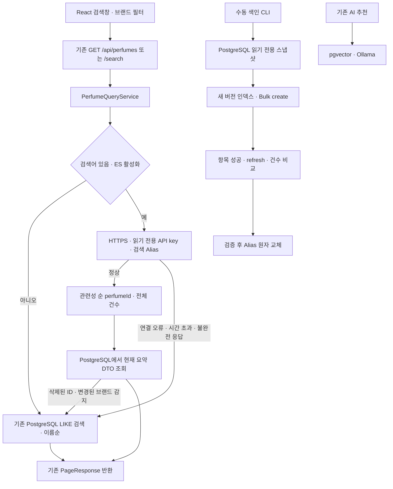

# Elasticsearch 선택 검색 엔진

2026-11-02 로컬 구현. **이 문서의 Ubuntu 명령은 실행하지 않았다.** Git 커밋·Push, Jenkins 실행, SSH 접속, 이미지 다운로드·빌드, 컨테이너 변경, 실제 DB 접속·변경, Elasticsearch 설치·색인은 별도 검토 후 운영자가 실행한다. 로컬 Java 테스트의 DB는 메모리 H2 픽스처이며 실제 PostgreSQL과 연결하지 않는다.

## 1. 구조와 기존 동작



기존 `PerfumeController`의 두 목록 경로는 같은 `list(page, size, q, brandSlug)`를 호출한다. `q`와 `brandSlug`의 검증, 기본 `page=0`, `size=20`, 최대 100개, 응답 필드 `content/page/size/totalElements/totalPages/first/last`는 같다. PostgreSQL 검색은 향수 이름·브랜드 이름·브랜드 slug의 대소문자 무시 LIKE이며 `%`, `_`, `!`는 이스케이프한다. 검색어가 없거나 비활성화 상태이면 기존 이름순·ID순 정렬을 사용한다.

React의 `catalogPath()`는 이미 검색어가 있으면 `/api/perfumes/search`를 사용한다. 따라서 제품 코드나 화면 디자인 변경 없이 서버의 선택 검색이 연결된다. 브랜드 변경·검색어 변경 시 페이지 초기화, 350ms 입력 지연, 기존 상세 페이지·AI 추천 흐름을 유지한다. 검색 점수나 검색 엔진 이름을 응답/UI에 추가하지 않는다.

PostgreSQL만 원본이며 ES는 다시 만들 수 있는 조회용 사본이다. ES에서 반환받은 ID를 PostgreSQL에서 최대 100건 조회한 뒤 ES의 순서로 재배열한다. 따라서 현재 이름·이미지·브랜드를 기존 DTO로 제공한다. ES의 `_score`는 쿼리·문서 분포에 따른 상대적 관련성으로, 정확도·확률·백분율로 해석하지 않는다.

## 2. 검색 처리와 실패 경로

| 구성 요소 | 역할 |
| --- | --- |
| `CatalogSearch` | 외부 검색 엔진과 카탈로그 서비스의 경계. `Optional.empty()`는 SQL 경로를 선택한다. |
| `ElasticsearchConfiguration` | 활성화 시에만 CA·API key를 읽고 HTTP client를 생성한다. 설정 오류도 SQL로 복귀한다. |
| `ElasticHttpTransport` | 기본 JDK HTTP client/Jackson으로 ES REST 호출. 별도 ES 자동 설정·repository 탐색·의존성 추가 없음. |
| `ElasticsearchQuery` | 사용자 문자열을 JSON 값으로 전달하며 ES query-string 문법으로 실행하지 않는다. |
| `ElasticsearchCatalogSearch` | 전체 건수·샤드 실패·시간 초과·ID 형식을 검증하고 장애 시 SQL로 복귀한다. |
| `PerfumeQueryService` | ES ID를 PostgreSQL DTO로 변환하고 관련성 순서를 유지한다. |
| `JdbcCatalogSnapshot` | 원본과 노트·어코드를 같은 읽기 전용 스냅샷으로 읽는다. |
| `ElasticsearchReindexer` | 새 인덱스만 작성·검증하고 마지막에 Alias를 교체한다. |

검색 쿼리는 이름 8, 브랜드 5, 각 노트·어코드 2, 설명 1의 기본 가중치를 사용한다. 이름·브랜드 구문 일치는 추가 가중치를 갖는다. 기본 텍스트에는 소문자·악센트 정규화와 검색 시점 `synonym_graph`를 사용하고, `.ko` 하위 필드는 Nori로 한국어 복합어를 분석한다. 동의어 필터와 Nori 토큰 그래프를 같은 체인에 섞지 않는다. 예제 사전에는 `크리드/creed`, `아벤투스/aventus`, `장미/rose`, `머스크/musk` 등이 있다. 사전은 제한된 출발점이며 임의의 한글 표기나 영문 고유명사를 자동 번역하지 않는다.

오타 검색은 별도의 `catalog_plain` 분석기와 `AUTO` fuzziness, 접두 1글자, 최대 25개 확장으로 제한한다. 동의어와 fuzziness를 같은 토큰 확장에 적용하지 않는다. `_score desc`, `perfumeId asc`로 동점 정렬을 고정하고, `brandSlug`는 keyword `term` 필터로 적용한다. `track_total_hits=true`로 정확한 ES 건수를 요청한다.

연결 제한 300ms, 검색 HTTP 제한 1,500ms, ES 쿼리 제한 800ms, 동시 검색 최대 4개다. 연결 실패·인증 실패·429·5xx·부분 응답·시간 초과를 정상 0건으로 처리하지 않으며 SQL로 복귀한다. 첫 장애 후 15초 동안 ES 호출을 건너뛰고, 이후 요청에서 복구를 시도한다. 동시 요청 한도 초과는 대기 없이 SQL로 간다. 경고에는 검색어·문서·자격 증명을 기록하지 않는다.

검색어가 없는 목록과 기존 backend healthcheck는 ES를 호출하지 않는다. 정상 0건 응답은 그대로 0건을 반환한다. `from + size > 10,000`인 깊은 페이지는 기존 SQL로 처리하므로 그 구간의 결과·정렬·건수는 SQL 기준이다. 장애 복귀 시에도 노트·동의어·오타 검색과 관련성 정렬은 제공되지 않으며 이름·브랜드 LIKE 범위로 줄어든다. 엔진 변경·재색인 중 여러 페이지를 이동하면 결과가 달라질 수 있다. 기존 페이지 번호 API의 제약이며, PIT/search_after 기반 커서 API는 향후 별도 설계 대상이다.

## 3. 설정·실행 환경

| 환경변수 | 기본값 / 용도 |
| --- | --- |
| `PERFUME_ELASTICSEARCH_ENABLED` | `false`. 일반 검색만 선택적으로 활성화한다. |
| `PERFUME_ELASTICSEARCH_URL` | 활성화 시 필수. HTTPS 원점만 허용하며 URL 내 계정·경로·query·fragment 금지. |
| `PERFUME_ELASTICSEARCH_ALIAS` | `perfumes-search`. 소문자·숫자·하이픈으로 제한. |
| `PERFUME_ELASTICSEARCH_CA_FILE` | 활성화/색인 시 필수. 신뢰할 CA 인증서 경로. hostname 검증 유지. |
| `PERFUME_ELASTICSEARCH_API_KEY_FILE` | 웹 검색 전용 encoded API key 파일. 읽기 권한만 부여. |
| `PERFUME_ELASTICSEARCH_INDEX_API_KEY_FILE` | 수동 색인 전용 encoded API key 파일. 웹 컨테이너에 전달하지 않음. |
| `PERFUME_REINDEX_IMAGE` | 수동 job에서 사용할 검토된 backend 이미지 ID. |

`compose.yaml`과 `Jenkinsfile`은 수정하지 않았다. `compose.elasticsearch.yaml`은 `search` profile의 새 ES 서비스·새 볼륨·새 internal 네트워크만 추가한다. `compose.elasticsearch-app.yaml`은 별도 검토 후 backend에 네트워크와 읽기 key를 붙일 때만 사용한다. `compose.elasticsearch-reindex.yaml`은 `search-index` profile의 수동 일회성 job이다. ES를 backend의 실행 의존성으로 추가하지 않는다.

공식 `docker.elastic.co/elasticsearch/elasticsearch:8.19.23`에 같은 배포판의 공식 `analysis-nori` plugin만 설치한 파생 이미지를 사용한다. 버전은 Dockerfile에 고정했다. HTTP TLS·인증을 켜고 호스트 포트를 게시하지 않는다. 노드 간 transport는 loopback에만 바인딩한다. CA 검증을 생략하는 `-k`나 trust-all 설정을 사용하지 않는다. Bootstrap 비밀번호와 API key는 Git 제외 경로 `.secrets/`에 두고 Compose secret으로 마운트한다. 검색 key는 alias의 `read`만, 색인 key는 카탈로그 prefix의 관리·생성·쓰기·읽기 권한만 갖는다. 색인 key의 `manage` 권한은 해당 prefix의 삭제 권한도 포함하므로 단기 key를 발급하고 수동 작업자로 접근을 제한한다. 검색 key는 90일, 색인 key는 1일 만료이며 별도 갱신이 필요하다.

## 4. Ubuntu 예상 자원 부담

서버 접속·계측은 하지 않았다. 기존 Compose 주석의 **4코어/16GB VM**과 Ollama 6GiB 상한을 기준으로 한 초기 예산이며 실제 여유 메모리를 뜻하지 않는다.

| 항목 | 설정 / 예상 부담 |
| --- | --- |
| ES 단일 노드 | CPU 1개 상한, 컨테이너 메모리 2GiB 상한, JVM heap 1GiB 고정 |
| 수동 색인 job | CPU 0.5개 상한, 메모리 768MiB 상한, JVM heap 512MiB |
| 기존 Ollama | Compose의 6GiB 상한 유지. 모델·볼륨·동시성 설정 변경 없음. |
| 정상 검색 시 추가 예산 | ES 최대 2GiB + backend의 소규모 client/요청 버퍼. 시작·GC·page cache를 포함해 호스트 여유 3~4GiB를 먼저 확인. |
| 재색인 시 추가 예산 | ES와 CLI 합계 최대 2.75GiB. 기존 PostgreSQL 읽기·디스크 I/O도 증가. |
| 디스크 | 실데이터 크기 미측정. 토큰·역색인·doc values 등으로 원문 크기만으로 확정 불가. 현재 인덱스와 새 인덱스, merge 작업 공간을 함께 확보. |

예를 들어 OS/파일 캐시 2~3GiB, PostgreSQL 1~3GiB, backend/frontend 1~2GiB, Jenkins와 빌드 1~3GiB, Ollama 4~6GiB를 사용하면 ES 추가 전에 이미 9~17GiB 범위다. **16GB에 안전하게 들어간다고 보장할 수 없다.** Jenkins 빌드·모델 추론·전체 색인의 동시 실행을 피하고 실측 후 활성화한다. 기존 서비스의 메모리 상한을 임의로 낮추지 않는다. 필요하면 VM 증설이나 검색 노드 분리를 먼저 검토한다.

`node.store.allow_mmap=false`로 호스트 `vm.max_map_count` 변경을 요구하지 않는 개발 구성을 택했다. mmap 성능 이점은 줄어들 수 있으며 실부하 측정 후 조정한다. 재색인은 200건 단위로 읽고 전송하며 30분 경과 또는 인터럽트 시 다음 batch에서 중단한다. DB 질의 제한은 30초, 색인 HTTP 요청 제한도 30초다. 긴 REPEATABLE READ 스냅샷은 PostgreSQL VACUUM 정리를 지연할 수 있으므로 대량 색인은 조용한 시간대에 수행한다.

## 5. 색인·동기화·복구 원칙

수동 `java -jar ... --elasticsearch-reindex=full`은 Spring context 생성 전에 분기한다. JPA·스키마 초기화·importer·RAG·웹 서버·WebSocket을 시작하지 않는다. 환경변수만으로 색인이 실행되지 않으며 이 CLI 인자를 단독으로 명시해야 한다.

1. PostgreSQL 연결을 read-only, REPEATABLE READ로 설정하고 전용 transaction advisory lock을 획득한다. 동시 CLI 색인을 차단하며 종료 시 rollback/close로 해제한다.
2. 같은 스냅샷의 향수 전체 건수를 기록한다. 0건이면 기존 정상 alias 보호를 위해 중단한다.
3. `perfumes-search-v-<epochMillis>-<UUID>`라는 새 인덱스를 생성한다. mapping의 11개 필드는 `perfumeId/name/brandName/brandSlug/description/releaseYear/topNotes/middleNotes/baseNotes/unlayeredNotes/accords`다.
4. ID keyset 순으로 최대 200개씩 읽는다. 노트/어코드의 다중 JOIN 곱집합을 피하고 각 배열을 서브쿼리로 읽는다. `_id=perfumeId`, Bulk `create`로 새 인덱스만 작성한다.
5. 모든 Bulk 항목의 201 응답·ID를 확인하고 refresh 성공, ES `_count`, PostgreSQL 스냅샷 건수, 처리 건수를 비교한다. 하나라도 다르면 게시하지 않는다.
6. 시작 시의 alias 상태가 유지되는지 확인하고 기존 target 제거와 새 target 추가를 단일 `_aliases` 요청으로 보낸다. 기존 target 제거에는 `must_exist=true`를 사용한다. 게시 후 target을 다시 확인한다. Alias는 검색용으로 `is_write_index=false`다.
7. 성공 로그의 `source/indexed/index/previous/alias`를 작업 기록으로 남긴다. 오래된 인덱스와 실패한 새 인덱스는 자동 삭제하지 않는다.

전체 색인은 **스냅샷 시점의 일관성**을 보장한다. 이후의 향수 추가·수정·삭제를 자동 반영하지 않는다. 색인 중 importer/수정 작업을 멈추거나, 작업 종료 후 데이터 변경 여부를 확인하고 필요 시 다시 전체 색인한다. 현재 데이터의 ID 증가만으로는 수정·삭제를 감지할 수 없으므로 ID cursor만으로 증분 동기화가 구현되었다고 보지 않는다.

불일치가 생기면 우선 `PERFUME_ELASTICSEARCH_ENABLED=false`로 SQL을 사용하고 PostgreSQL을 기준으로 전체 색인한다. ES 반환 ID가 삭제되었거나 브랜드 필터와 충돌하면 해당 페이지 전체가 SQL로 복귀하지만, **새로 추가된 향수의 누락이나 노트·설명 수정으로 바뀐 검색 일치 여부까지 탐지할 수는 없다.** 운영자가 데이터 변경 후 재색인을 수행해야 한다. 원본 DB를 ES 데이터로 덮어쓰는 복구는 없다.

향후 증분 동기화는 향수 변경 트랜잭션과 함께 이벤트를 저장하는 transactional outbox 또는 CDC를 검토한다. Worker는 `perfumeId`와 증가 버전으로 idempotent upsert/delete를 수행하고 재시도·지연·실패 이벤트를 관측해야 한다. 삭제에는 tombstone이 필요하다. Alias 교체 중에는 스냅샷 watermark 이후 이벤트를 새 인덱스에 재생한 뒤 전환해야 한다. 현재는 outbox 테이블·트리거·스케줄러·dual write를 추가하지 않았다.

동의어 또는 mapping 변경은 JSON 리소스 버전을 올린 뒤 전체 재색인으로 적용한다. 자동완성이 필요하면 `name/brandName`에 `search_as_you_type` 또는 별도 prefix 필드를 추가하고 별도 query builder/API를 붙일 수 있다. 이 경우에도 새 인덱스+alias 방식으로 교체한다. 기존 API에 autocomplete나 score 필드를 미리 노출하지 않았다.

## 6. Ubuntu 적용 명령 — 별도 검토 후 실행

아래 명령은 `/srv/perfume`에 검토된 소스와 해당 backend 빌드가 준비된 후, 기존 배포 담당자와 작업 시간을 조율해 실행한다. Jenkins 배포는 서버 `.env`의 `PERFUME_ELASTICSEARCH_ENABLED=true`일 때만 backend 연결 override와 외부 네트워크 참조를 적용한다. 기존 HTTP 인증 override도 함께 유지한다. ES 서비스/색인 job은 Jenkins가 실행하지 않는다. 최초 적용·비밀 파일 보호·비활성화의 자세한 결정 규칙은 [Jenkins Elasticsearch 배포 정책](jenkins-elasticsearch.md)을 따른다.

### 6.1 읽기 전용 사전 점검

```bash
cd /srv/perfume
free -h
nproc
df -h /srv/perfume
docker stats --no-stream
docker compose version
test -f /srv/perfume/.env
```

같은 Bash 세션에서 다음 함수를 정의한다. 실제 `.env`를 출력하거나 덮어쓰지 않는다. 자동 배포 때 쓰는 승인된 DB 이미지 환경 등은 그대로 유지한다.

```bash
unset COMPOSE_FILE COMPOSE_PROJECT_NAME COMPOSE_PROFILES
base() {
  docker compose --project-name perfume-dev --project-directory /srv/perfume \
    --env-file /srv/perfume/.env -f /srv/perfume/compose.yaml "$@"
}
es_infra() {
  base -f /srv/perfume/compose.elasticsearch.yaml --profile search "$@"
}
es_app() {
  base -f /srv/perfume/compose.elasticsearch.yaml \
    -f /srv/perfume/compose.elasticsearch-app.yaml --profile search "$@"
}
es_index() {
  base -f /srv/perfume/compose.elasticsearch.yaml \
    -f /srv/perfume/compose.elasticsearch-reindex.yaml --profile search-index "$@"
}
```

### 6.2 신규 secret·인증서 준비 — 호스트 파일 생성

인증서는 예제 자체 CA 방식이다. 기존 조직 CA가 있으면 검토된 서버 인증서/CA로 대체한다. `.secrets/elasticsearch`가 이미 있으면 재실행해 덮어쓰지 말고 기존 인증서·key를 확인한다. 아래는 최초 1회 준비용이다.

```bash
(
set -eu
test ! -e .secrets/elasticsearch
umask 077
mkdir -p .secrets/elasticsearch/ca .secrets/elasticsearch/node
openssl req -x509 -newkey rsa:3072 -nodes -sha256 -days 3650 \
  -keyout .secrets/elasticsearch/ca/ca.key \
  -out .secrets/elasticsearch/node/ca.crt -subj '/CN=Perfume Search Development CA'
openssl req -new -newkey rsa:3072 -nodes \
  -keyout .secrets/elasticsearch/node/server.key \
  -out .secrets/elasticsearch/ca/server.csr -subj '/CN=elasticsearch'
cat > .secrets/elasticsearch/ca/server.ext <<'EOF'
subjectAltName=DNS:elasticsearch,DNS:localhost,IP:127.0.0.1
basicConstraints=critical,CA:FALSE
keyUsage=critical,digitalSignature,keyEncipherment
extendedKeyUsage=serverAuth
EOF
openssl x509 -req -in .secrets/elasticsearch/ca/server.csr \
  -CA .secrets/elasticsearch/node/ca.crt -CAkey .secrets/elasticsearch/ca/ca.key \
  -CAcreateserial -CAserial .secrets/elasticsearch/ca/ca.srl \
  -out .secrets/elasticsearch/node/server.crt -days 365 -sha256 \
  -extfile .secrets/elasticsearch/ca/server.ext
openssl rand -hex 32 > .secrets/elasticsearch/elastic-password
chmod 644 .secrets/elasticsearch/node/ca.crt .secrets/elasticsearch/node/server.crt
chmod 640 .secrets/elasticsearch/node/server.key .secrets/elasticsearch/elastic-password
sudo chown -R 1000:0 .secrets/elasticsearch/node
sudo chmod 750 .secrets/elasticsearch/node
sudo chown 1000:0 .secrets/elasticsearch/elastic-password
)
```

CA 개인키는 `ca/`에 남겨 두고 컨테이너에 마운트하지 않는다. ES 컨테이너는 UID 1000/GID 0, backend와 수동 job은 기존 이미지 UID 10001이다. 실제 rootless Docker 또는 user namespace remapping 환경이면 매핑된 UID에 맞는 접근 권한을 별도로 확인한다.

### 6.3 Elasticsearch만 시작 — 기존 서비스 재생성 없음

```bash
es_infra config --quiet
es_infra build elasticsearch
es_infra up -d --no-deps --no-build --wait --wait-timeout 180 elasticsearch
es_infra ps elasticsearch
```

Dockerfile 빌드 단계에서 공식 이미지와 Nori를 다운로드한다. 런타임에는 검색 전용 internal 네트워크만 사용하고 호스트 9200/9300 포트는 열지 않는다. healthcheck의 401은 TLS 연결과 인증 요구 여부만 확인한다. 실제 클러스터 상태는 아래 인증 요청으로 따로 검증한다.

Bootstrap 계정은 초기 key 발급/운영 점검에만 사용한다. 다음 helper는 비밀번호를 argv나 로그에 넣지 않고 curl 설정 전용 file descriptor로 전달한다. shell tracing(`set -x`)을 켜지 않는다.

```bash
es_admin() {
  es_infra exec -T elasticsearch bash -c '
    set -eu
    exec 3< <(printf "user = \"elastic:%s\"\n" "$(cat /run/secrets/elastic_bootstrap_password)")
    curl --config /dev/fd/3 --silent --show-error --fail \
      --cacert config/certs/ca.crt "$@"
  ' bash "$@"
}
es_admin 'https://localhost:9200/_cluster/health?wait_for_status=yellow&timeout=30s'
```

### 6.4 권한별 API key 발급 — ES 보안 데이터 생성

key 응답 파일도 secret이다. 화면에 출력하지 않는다. 각 JSON template은 비밀번호를 포함하지 않는 권한 명세다. 생성된 encoded 값을 Java가 읽는다.

```bash
umask 077
es_admin -X POST 'https://localhost:9200/_security/api_key' \
  -H 'Content-Type: application/json' --data-binary @- \
  < docker/elasticsearch/search-api-key.json > .secrets/elasticsearch/search-key-response.json
es_admin -X POST 'https://localhost:9200/_security/api_key' \
  -H 'Content-Type: application/json' --data-binary @- \
  < docker/elasticsearch/index-api-key.json > .secrets/elasticsearch/index-key-response.json
python3 - <<'PY'
import json
from pathlib import Path
root = Path('.secrets/elasticsearch')
for kind in ('search', 'index'):
    data = json.loads((root / f'{kind}-key-response.json').read_text())
    (root / f'{kind}-api-key').write_text(data['encoded'] + '\n')
PY
sudo chown 10001:10001 .secrets/elasticsearch/search-api-key .secrets/elasticsearch/index-api-key
sudo chmod 400 .secrets/elasticsearch/search-api-key .secrets/elasticsearch/index-api-key
```

API key 갱신 때는 새 파일로 발급·검증 후 교체하고 backend를 재생성한다. client는 파일을 시작 시 읽으므로 파일 변경만으로 갱신되지 않는다. 만료된 읽기 key는 인증 오류로 SQL 복귀한다. Bootstrap 비밀번호는 최초 ES 데이터 디렉터리 초기화용이며 파일만 바꿔도 기존 계정 비밀번호가 바뀌지는 않는다. 비밀번호 회전은 ES 보안 API/공식 절차로 따로 수행한다.

### 6.5 수동 전체 색인 — 원본 DB 읽기, 새 ES 인덱스 작성

검토된 backend 이미지에 이번 CLI 코드가 들어 있어야 한다. 아래는 현재 backend의 이미지 ID를 읽어 같은 아티팩트를 사용한다. Jenkins를 실행하거나 이미지를 새로 배포하는 명령은 포함하지 않는다.

```bash
export PERFUME_REINDEX_IMAGE="$(docker inspect --format '{{.Image}}' "$(base ps -q backend)")"
es_index config --quiet
es_index run --rm --no-deps elasticsearch-reindex
es_admin 'https://localhost:9200/_alias/perfumes-search'
es_admin 'https://localhost:9200/perfumes-search/_count'
```

로그의 `sourceCount`, `processed`, 최종 `indexed`를 비교한다. 별도로 원본 현재 건수를 확인하려면 기존 psql 접근 방식으로 `SELECT count(*) FROM public.perfumes;`만 실행한다. 색인 중 데이터가 변경되면 현재 건수와 스냅샷 건수는 다를 수 있다. 색인 key가 만료되었으면 새 단기 key를 발급한다. 실패한 새 인덱스나 이전 인덱스의 정리·삭제는 별도 검토 작업이다.

### 6.6 backend 선택 활성화 — backend만 재생성

이 단계는 기존 서비스에 영향을 주므로 ES 단독 검증·색인 성공 확인 후에만 실행한다. 세션을 메모리에 저장하는 기존 구성에서는 backend 재시작으로 로그인 세션과 WebSocket 연결이 끊길 수 있다. 프런트엔드·DB·Ollama는 재생성하지 않는다.

```bash
PERFUME_ELASTICSEARCH_ENABLED=true es_app up -d --no-deps --no-build --force-recreate backend
es_app ps backend
curl --fail --get 'http://127.0.0.1:8088/api/perfumes/search' \
  --data-urlencode 'q=크리드' --data-urlencode 'brandSlug=creed' \
  --data-urlencode 'page=0' --data-urlencode 'size=20'
```

검증표: 향수명 `Aventus`, 브랜드 `Creed/크리드`, 노트 `Bergamot/베르가못`, 어코드 `woody/우디`, 한글 원문, 오타 `aventuss`, 브랜드 필터, 페이지 0/1과 전체 건수, 양쪽 API 응답을 확인한다. 실제 원본에 해당 향수·노트가 있는지 먼저 확인한다. 검색 전용 key에 쓰기 권한이 없음을 확인하고 브라우저 검색·상세·AI 추천·로그인·고객센터를 점검한다. 장애 전환은 별도로 승인된 시간에 ES만 중지한 후 기존 API 응답을 확인한다.

## 7. 장애 복귀·Alias 롤백

네트워크/인증/검색 오류는 자동 SQL 복귀한다. 영구적으로 끄려면 환경변수를 false로 적용하면서 backend만 재생성한다. 환경변수 변경은 재시작 전까지 적용되지 않는다.

```bash
PERFUME_ELASTICSEARCH_ENABLED=false es_app up -d --no-deps --no-build --force-recreate backend
curl --fail --get 'http://127.0.0.1:8088/api/perfumes/search' --data-urlencode 'q=Aventus'
```

secret 파일이 손상되어 override 자체가 적용되지 않으면, 기존 승인된 배포 설정을 사용해 `base up -d --no-deps --no-build --force-recreate backend`로 돌아간다. 기본 Compose에는 ES flag와 secret/network가 없으므로 SQL 검색이 된다. 필요하면 **ES만** `es_infra stop elasticsearch`로 중지한다. 기존 PostgreSQL/Ollama 볼륨과 ES 볼륨은 보존한다. `down -v`, `volume prune`, DB 재생성·초기화·데이터 역복사는 하지 않는다.

검색 품질 문제로 이전 인덱스를 사용하려면 먼저 alias의 현재 target, 성공 로그의 `previous`, 해당 인덱스의 건수/상태를 확인한다. 수동 색인과 다른 alias 변경 작업을 동시에 실행하지 않는다. 아래 JSON의 두 target을 **검증된 실제 이름**으로 바꿔 단일 요청을 보낸다.

```bash
es_admin -X POST 'https://localhost:9200/_aliases' \
  -H 'Content-Type: application/json' --data-binary @- <<'JSON'
{"actions":[
  {"remove":{"index":"perfumes-search-v-CURRENT","alias":"perfumes-search","must_exist":true}},
  {"add":{"index":"perfumes-search-v-PREVIOUS","alias":"perfumes-search","is_write_index":false}}
]}
JSON
es_admin 'https://localhost:9200/_alias/perfumes-search'
```

Alias 요청 직후 응답 시간 초과·프로세스 종료가 발생하면 성공 여부가 불확실하다. 기존/새 인덱스는 남기고 `_alias`를 조회해 현재 target을 확인한다. 무조건 같은 작업을 재시도하거나 새 인덱스를 삭제하지 않는다. 프로그램의 advisory lock은 지원되는 수동 CLI끼리만 직렬화하며 별도 관리자의 직접 Alias API 호출을 차단하지는 않는다.

## 8. 파일과 검증 범위

전체 결과·실행 환경·변경 파일 목록은 [elasticsearch-validation.md](elasticsearch-validation.md)에 기록한다. 실제 ES 통합 테스트는 `ElasticsearchLiveTests`에 별도 gate를 둔다. **이번에는 실행하지 않는다.** 실행하려면 폐기 가능한 별도 노드·CA·`perfumes-test-*`에만 권한이 있는 테스트 key를 준비하고 다음 변수만 명시한다.

```bash
PERFUME_ELASTICSEARCH_LIVE_TEST=true
PERFUME_ELASTICSEARCH_TEST_URL=https://DISPOSABLE-TEST-HOST:9200
PERFUME_ELASTICSEARCH_TEST_CA_FILE=/reviewed/test-ca.crt
PERFUME_ELASTICSEARCH_TEST_API_KEY_FILE=/reviewed/test-api-key
# 위 변수를 export한 별도 승인 세션에서만:
./mvnw -Dtest=ElasticsearchLiveTests test
```

통합 테스트는 임의의 `perfumes-test-<UUID>` alias/새 인덱스에 픽스처를 넣고 이름·브랜드·노트·어코드·한국어·오타·필터·페이지를 확인한다. 테스트 인덱스는 확인을 위해 남기며 자동 삭제하지 않는다. 프로덕션 읽기/색인 key를 테스트에 재사용하지 않는다.

면접 설명의 핵심은 PostgreSQL의 원본 책임, ES의 역색인·관련성 순위 책임, 선택 검색 경계의 장애 격리, Bulk+스냅샷의 일관성, 버전 인덱스+Alias의 게시/복구 책임이다. DB와 ES 사이 분산 트랜잭션을 가정하지 않고, 현재 수동 재구축과 향후 outbox/CDC를 구분해 설명한다.

근거: [공식 Docker 배포와 8.19.23 이미지](https://www.elastic.co/guide/en/elasticsearch/reference/8.19/docker.html), [8.19.23 릴리스](https://www.elastic.co/guide/en/elasticsearch/reference/8.19/release-notes-8.19.23.html), [Nori tokenizer](https://www.elastic.co/guide/en/elasticsearch/plugins/8.19/analysis-nori-tokenizer.html), [multi_match와 가중치](https://www.elastic.co/guide/en/elasticsearch/reference/8.19/query-dsl-multi-match-query.html), [검색 시 synonym_graph](https://www.elastic.co/docs/reference/text-analysis/analysis-synonym-graph-tokenfilter), [Alias 교체](https://www.elastic.co/guide/en/elasticsearch/reference/8.19/aliases.html). 메모리 예산은 이 프로젝트 설정에 대한 추정이며 공급자의 실측 보장이 아니다.
