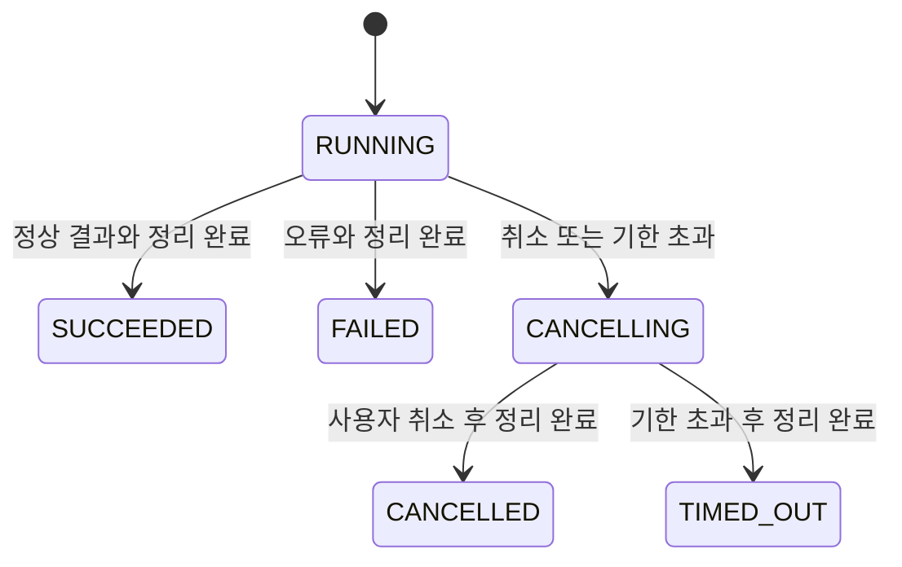

# AI 추천 작업·서버 취소·상태 조회

추천 제출을 짧은 작업 생성 요청과 상태 조회로 분리했다. 기존 `POST /api/ai/perfumes/recommend`도 유지한다. 두 경로는 같은 `PerfumeRecommendationService`의 추천 알고리즘과 실행 제한을 사용한다. 이 변경에서 Commit/Push, Jenkins 실행, Ubuntu 접속, 실제 DB/Ollama 호출, 컨테이너 시작·정지·재시작, 예약 활성화는 하지 않는다.

## API 계약

모든 작업 API에 `X-Recommendation-Token` 헤더가 필요하다. 브라우저가 `crypto.getRandomValues()`로 생성하는 **소문자 hex 64자리(256bit)** 접근 토큰이다. 서버는 토큰의 SHA-256만 보관하고, 별도로 UUID v4 작업 ID를 생성한다. 토큰은 URL·로그에 넣지 않는다.

| 메서드·경로 | HTTP | 동작 |
| --- | --- | --- |
| `POST /api/ai/perfumes/recommend/jobs` | 202 | 작업 생성. 입력은 기존 `{query, topK}` DTO 그대로 |
| `GET /api/ai/perfumes/recommend/jobs/{jobId}` | 200 | 해당 ID와 토큰이 일치하는 작업만 조회 |
| `POST /api/ai/perfumes/recommend/jobs/{jobId}/cancel` | 202 | 취소 요청. 본문 없음. 반복 호출 가능 |
| `GET /api/ai/perfumes/recommend/jobs` | 200 | **해당 토큰의 작업 하나만** 복구. 전체 작업 목록 API가 아님 |

생성 응답이 유실돼도 질문을 재전송하지 않고 토큰으로 작업 ID를 복구할 수 있다. 보관 중 같은 토큰으로 생성 요청을 다시 보내면 기존 작업을 반환하며 새 추론을 시작하지 않는다. 토큰은 한 작업의 접근 권한과 중복 생성 방지 키이므로, 새 추천에는 반드시 새 토큰을 사용한다. 보관 만료 후까지 중복 방지를 보장하는 영구 키는 아니다.

질문은 비어 있거나 공백만일 수 없고 최대 500 UTF-16 단위다. `topK`는 기본 5, 정수 1~20이다. 기존 엄격한 JSON DTO 검증과 고정 오류 코드 정책을 사용한다.

응답 예시(가상 ID):

```json
{
  "jobId": "11111111-1111-4111-8111-111111111111",
  "state": "RUNNING",
  "result": null,
  "errorCode": null,
  "errorStatus": null
}
```

`SUCCEEDED`에서만 `result`에 기존 `{answer, sources, returnedCount}`가 포함된다. 답변의 `[1]`은 여전히 `sources[0]`이다. 질문·프롬프트·원문·벡터는 작업 응답에 포함하지 않는다. `FAILED`/`TIMED_OUT`은 고정 `errorCode`와 원래 오류의 `errorStatus`를 포함한다. 예를 들어 `LLM_TIMEOUT/504`다. **조회 자체는 HTTP 200**이며 이 필드는 작업 실패 원인을 나타낸다. 원시 예외·외부 응답 detail은 노출하지 않는다.

작업 응답은 `Cache-Control: no-store`다. 잘못된/만료된/다른 토큰의 ID, 누락되거나 잘못된 토큰은 모두 동일한 `404 / RECOMMEND_JOB_NOT_FOUND`로 처리한다. 다른 작업의 존재를 알려 주지 않는다. 기존 비활성 `503 / RECOMMEND_DISABLED`, 입력 오류 400, 실행 중 추가 요청 `429 / RECOMMEND_BUSY` 정책은 유지한다. 서버가 아주 빨리 끝나면 생성·취소 응답에도 이미 확정된 완료 상태가 포함될 수 있다.

## 상태 전이와 경합



완료 상태는 변경하지 않는다. 완료가 먼저 확정되면 이후 취소에도 원래 완료 상태를 반환한다. 취소가 먼저 접수되면 늦게 돌아온 정상 답변도 폐기한다. 취소·기한 초과 중 먼저 접수한 종료 사유를 유지한다.

`CANCELLING`은 실제 종료 확인 전 상태다. `Future.cancel(true)` 직후의 `isDone()`으로 종료를 판정하지 않는다. 추천 실행부의 `finally`, 검색 실행부의 별도 종료 신호, 등록된 자원 해제를 확인한 뒤에만 완료 상태로 바꾼다. 풀의 스레드 객체는 재사용되므로 여기서 종료란 **해당 작업 실행의 종료**다.

검색 Future가 취소돼도 검색 함수가 아직 돌아오지 않았다면 추천 작업은 검색의 `finally` 신호를 기다린다. 인터럽트를 무시하는 작업이 실제로 남아 있으면 `CANCELLING`과 실행 슬롯을 유지한다. 취소 콜백을 해제하는 순간과 실행하는 순간도 동기화하여, 이전 작업의 늦은 콜백이 풀 스레드의 다음 작업을 인터럽트하지 못하도록 한다.

## 실행 제한·메모리·기한

기존 설정의 `max-concurrent=1`을 유지한다. 기존 동기 API와 작업 API가 하나의 admission 제한과 하나의 추천 실행기를 공유한다. 처리 중이거나 정리 중인 작업이 있으면 다른 생성 요청은 즉시 429이며 요청을 대기열에 쌓지 않는다. 완료 공개와 풀 스레드 복귀 사이의 아주 짧은 간격을 위한 큐만 최대 동시 실행 수로 제한한다. 새로운 요청은 이전 작업의 자원 정리가 끝난 후에만 이 인계에 들어갈 수 있다.

실행 중 작업은 자동 만료·용량 정리 대상이 아니다. 완료 작업만 정리한다.

| Spring 설정 | 기본값 | 범위 |
| --- | --- | --- |
| `perfume.ai.recommend.jobs.retention-ms` | 600000 (완료 후 10분) | 1000~3600000 |
| `perfume.ai.recommend.jobs.max-completed` | 64 | 1~256 |
| `perfume.ai.recommend.jobs.max-stored-bytes` | 2097152 (2MiB) | 65536~16777216 |

문자열의 UTF-16 크기와 결과 DTO·작업별 고정 예산을 합산하고, 개수/용량 한도를 넘으면 이전 완료 작업부터 삭제한다. 한 결과가 예산을 넘으면 결과를 보관하지 않고 안전한 실패로 처리한다. 이는 작업 캐시의 제한이며 JVM 전체 RSS 제한을 뜻하지 않는다. 과도한 사용 시 10분 전에도 완료 정보가 삭제될 수 있다. 정리 작업은 약 100ms 간격으로 동작하며 조회 요청이 없어도 만료된 결과를 제거한다. 질문은 실행에 필요한 동안만 보유하고 완료 기록에는 넣지 않는다.

기존 검색 읽기 60초·전체 120초, 추천 읽기/생성 300초·전체 420초, CPU 3개·RAM 6GB·Ollama 병렬/로드 모델 1개를 유지한다. 기존 일반 API Nginx 30초, 동기 추천의 정확한 경로 Nginx 450초와 호환 클라이언트 480초도 유지한다. **작업 생성·조회·취소 HTTP 요청은 각각 클라이언트 15초**이며 서버의 전체 작업 기한과 별개다. 새 Nginx location은 필요 없다.

## HTTP 취소의 실제 범위

추천별 취소 컨텍스트를 검색 자식 작업까지 전달한다. 사용자 취소/기한 초과 시 해당 스레드들을 인터럽트하고, 현재 HTTP 교환의 Future와 응답 body 구독을 취소한다. 인터럽트 상태를 지우는 코드가 있더라도 취소 컨텍스트 자체를 다시 확인하여 후속 단계가 진행되지 않게 한다.

Spring `RestClient`의 요청/응답 직렬화·모델 Digest 전후 검증·프롬프트/응답 검증은 재사용한다. 추천 경로의 실제 전송만 Java 17 `HttpClient.sendAsync`로 수행한다. 헤더와 제한된 body 전체 수신을 같은 요청 기한으로 제한한다. 전송 body 버퍼는 1MiB 이하이며 기존 LLM의 65536바이트 응답 검증도 유지한다. 연결 취소·타임아웃에는 해당 교환과 body 구독의 취소를 명시적으로 요청한다. 독립 의미 검색과 임베딩 배치는 기존 전송을 유지한다. DB 호출은 기존 읽기 전용 트랜잭션·쿼리 타임아웃과 자원 정리를 유지하며, 검색 실행부가 반환하기 전에는 슬롯을 풀지 않는다.

Java 17은 HTTP 교환의 취소와 자원 회수를 **시도**하며 정확한 원격 종료 시점을 보장하지 않는다. 관련 계약은 [Java 17 HttpClient 문서](https://docs.oracle.com/en/java/javase/17/docs/api/java.net.http/java/net/http/HttpClient.html#sendAsync(java.net.http.HttpRequest,java.net.http.HttpResponse.BodyHandler))에 명시되어 있다. 따라서 `CANCELLED`는 로컬 추천·검색 실행 및 등록된 전송 정리가 끝났다는 뜻이다. Ollama 내부 추론 종료를 별도 상태 API로 확인했다는 뜻이 아니다. TCP 자원 해제도 JDK 내부에서 비동기로 마무리될 수 있다.

Ollama 원격 계산이 즉시 중단됐다고 보장하거나 다른 요청을 종료하지 않는다. 전체 Ollama/컨테이너 재시작, 모델 unload/stop, `Thread.stop()` 등으로 취소하지 않는다. I/O가 즉시 반환하지 않으면 기존 제한과 종료 신호에 따라 안전하게 기다린다. 로컬 호출이 끝나지 않았는데 상태만 완료로 바꾸거나 동시성을 늘려 우회하지 않는다.

## React 동작과 장애 복구

- 약 2초 간격으로 직전 조회가 끝난 후 다음 조회를 예약한다. 한 확인 주기의 자동 조회는 최대 450회이며 이후에는 `상태 확인 불가`로 멈춘다. 통신 시간 외 약 15분의 조회 예산이다. 실패한 HTTP 요청을 자동 재시도하거나 추천 작업을 자동 재생성하지 않는다.
- 취소 직후에는 `AI 추천을 취소하는 중입니다`를 표시한다. 서버의 완료 상태가 확인될 때까지 입력·추천 제출을 막는다. 작업 생성 응답 전에 취소를 눌러도 ID를 받으면 취소를 전달한다.
- 조회/취소 응답의 네트워크 오류·기한 초과·형식 오류는 종료로 추측하지 않고 `작업 상태 확인 불가`로 멈춘다. 같은 작업의 `상태 다시 확인` 또는 명시적 취소만 허용한다. 생성 응답이 유실되면 기존 토큰으로 복구한다. 모호한 프록시 오류에도 새 작업을 자동 생성하지 않는다.
- `sessionStorage`에는 **작업 ID와 토큰만** 보관한다. 질문·답변·프롬프트는 저장하지 않는다. 완료 상태를 확인하면 이 핸들을 삭제한다. 같은 탭의 새로고침·SPA 재진입 시 핸들을 복구해 실제 상태를 다시 확인한다. 폴링 요청의 세대와 작업 ID를 검사하여 취소된 조회나 이전 작업의 결과를 새 작업에 표시하지 않는다.
- 이탈/탭 닫기에 자동 서버 취소를 가장하지 않는다. 이탈 시 진행 중인 브라우저 HTTP와 폴링만 중단하며 **서버 작업은 계속될 수 있다.** 명시적 취소를 눌렀어도 전송 중 이탈하면 요청이 서버에 도착하지 않을 수 있으므로 돌아와 상태를 확인한다.
- 탭을 닫거나 세션 저장소를 사용할 수 없어 핸들이 소실되면 복구가 불가능할 수 있다. 이 경우에도 서버 동시 실행 제한이 새 요청을 보호한다. 서버 재시작/보관 만료/접근 불가의 404는 별도 안내하며 이전 작업이 취소됐다고 표시하지 않는다. 새 요청의 실행 가능 여부를 서버가 다시 검사한다.

프로세스 재시작 시 작업 기록은 사라진다. DB 작업 테이블·상태 저장·복구용 임베딩 실행은 없다. 재시작 전 결과를 복원할 수 없고 원격 Ollama의 상태까지 추정하지 않는다.

## 개발 LAN 보안 한계

UUID와 별도 접근 토큰을 모두 확인하므로 작업 ID만으로 타인의 결과를 보거나 취소할 수 없다. 토큰 복구 경로도 목록·현재 전역 작업·사용자 수를 반환하지 않는다. 길이와 형식을 제한하고 고정 오류만 반환한다. 실행/보관 개수와 body 크기를 제한해 무제한 작업 큐와 상태 저장을 막는다.

이는 사용자 인증이 아니다. 신뢰할 수 없는 LAN 사용자는 자신의 토큰으로 요청을 계속 보내 CPU와 HTTP 처리 자원을 소비할 수 있다. 무작위 ID/토큰은 서버 접근 빈도 제한을 대신하지 않는다. HTTP 주소의 토큰은 네트워크 도청이나 같은 출처의 XSS에 노출될 수 있고 세션 저장소도 XSS로부터 보호되지 않는다. 외부 노출 전 인증·사용자별 사용량 제한·조회 rate limit·TLS/네트워크 접근 통제가 필요하다. 현재 주소 **192.168.0.19:8088은 개인 개발 LAN 전용**이다.

질문·답변·키·DB 비밀번호·원문·벡터·토큰을 로그에 출력하지 않는다. HTTP header/body TRACE, 프록시 요청 본문 로깅을 켜지 않는다. 실패 로그는 고정 상태·코드만 사용한다. 작업 DTO의 `toString()`도 결과를 제외한다. 자동 진행률이나 Ollama 원격 추론 완료를 나타내는 가짜 단계는 없다.

## Jenkins 반영 후 관리자 확인 예시

아래는 **이후 관리자 실행용 예시**이며 이번 작업에서는 실행하지 않는다. 기존 배포는 backend → frontend 순서라 새 API가 준비된 후 화면을 교체한다. 활성화 플래그와 두 모델 Digest는 [LAN 활성화 문서](perfume-ai-lan-activation.md)를 따른다. 추가 인프라·DB 변경은 없다.

```bash
set +x
JOB_TOKEN="$(openssl rand -hex 32)"
JOB_RESPONSE="$(curl --fail --silent --show-error --max-time 15 \
  -H 'Content-Type: application/json' -H "X-Recommendation-Token: $JOB_TOKEN" \
  --data '{"query":"저장된 시트러스 노트를 바탕으로 추천해 주세요.","topK":5}' \
  http://192.168.0.19:8088/api/ai/perfumes/recommend/jobs)"
JOB_ID="$(printf '%s' "$JOB_RESPONSE" | python3 -c 'import json,sys; print(json.load(sys.stdin)["jobId"])')"
unset JOB_RESPONSE
```

작업 조회(아래 예시는 답변 대신 상태만 출력):

```bash
curl --fail --silent --show-error --max-time 15 \
  -H "X-Recommendation-Token: $JOB_TOKEN" \
  "http://192.168.0.19:8088/api/ai/perfumes/recommend/jobs/$JOB_ID" \
  | python3 -c 'import json,sys; d=json.load(sys.stdin); print(d["state"], d.get("errorCode"), (d.get("result") or {}).get("returnedCount"))'
```

취소 접수 후에도 완료 상태를 조회해 실제 정리를 확인한다. 이미 성공했다면 성공 상태가 유지되는 것이 정상이다.

```bash
curl --fail --silent --show-error --max-time 15 -X POST \
  -H "X-Recommendation-Token: $JOB_TOKEN" \
  "http://192.168.0.19:8088/api/ai/perfumes/recommend/jobs/$JOB_ID/cancel" \
  | python3 -c 'import json,sys; print(json.load(sys.stdin)["state"])'
```

생성 응답 유실 시 본문 재전송 없이 복구:

```bash
curl --fail --silent --show-error --max-time 15 \
  -H "X-Recommendation-Token: $JOB_TOKEN" \
  http://192.168.0.19:8088/api/ai/perfumes/recommend/jobs \
  | python3 -c 'import json,sys; d=json.load(sys.stdin); print(d["jobId"], d["state"])'
```

취소 처리 중 새 토큰의 생성 요청은 429인지, 정리 완료 후에는 새 추천이 가능한지, 잘못된 토큰의 조회·취소는 동일한 404인지 확인한다. 실제 Ollama 응답·네트워크 종료 시간은 배포 후 별도로 확인해야 하며 Mock 결과만으로 원격 추론 중단을 단정하지 않는다. Jenkins healthcheck나 자동 테스트에 실제 AI 호출을 넣지 않는다.

## 호환성과 복귀

기존 동기 `POST /recommend`는 기존 결과와 오류 계약을 유지하고 같은 실행 제한을 사용한다. 장시간 동기 연결을 브라우저에서 끊는 것만으로 서버 취소를 보장하지 않는 기존 한계는 남으므로 새 화면은 작업 API를 사용한다. 새 API 오류 시 동기 API로 자동 fallback하여 중복 작업을 만들지 않는다.

필요하면 이전 정상 frontend를 기존 Jenkins 절차로 다시 반영할 수 있다. 새 backend의 동기 API와 호환되지만 취소는 이전의 브라우저 대기 취소로 돌아간다. backend까지 복귀해야 하면 검토된 이전 앱 버전을 같은 배포 잠금/보호 절차로 반영한다. DB 마이그레이션·복원·삭제, Ollama 모델/임베딩 변경, 자동 예약 활성화는 필요 없다. 전체 AI 비활성화는 기존 `.env` 두 플래그를 `false`로 바꾸고 정상 앱 재배포 절차를 따른다.

## Mock 검증

JUnit은 실제 실행 종료 신호, 검색 자식의 지연 종료, 취소/완료 경합, 반복 취소, 공유 실행 제한, 고정 실패, 결과 폐기, 보관 TTL/개수/용량, 개별 HTTP 교환·body 구독 취소를 검사한다. React 단위/브라우저 Mock은 생성·폴링·취소 중 제출 차단, 상태 확인 불가, 새로고침/이탈 복원, 이전 응답 무시, 출처·검색·상세 회귀와 개인정보 비저장을 검사한다. 외부 작업은 Mock이며 실제 DB/Ollama/컨테이너 호출이 아니다.

### 2026-10-18 검증 결과

| 실행 | 결과 |
| --- | --- |
| 관련 Maven 테스트 | 383개 통과, 실패/오류/건너뜀 0 |
| 실패 로그 비노출 검사 보강 후 `PerfumeRecommendationJobTests` 재실행 | 10개 통과 |
| `npm.cmd test` | 47개 통과 |
| `npm.cmd run build` | 성공 |
| Playwright 전체 Mock 회귀 | 78개 통과 (PC·태블릿·모바일) |
| 최종 취소 의도 초기화 보완 후 Playwright 주요 흐름 재검증 | 9개 통과. 기존 6개 재검증 + 신규 3개, 고유 사례 총 81개 |
| 문서의 Bash 예시 4개 | `bash -n` 구문 검사 통과. 예시 명령 자체는 실행하지 않음 |
| `git diff --check` | 통과 |

Maven은 Windows의 기존 캐시를 이용한 오프라인 실행이다. `target/recommendation-jobs-validation-pom.xml`에서 소스·리소스·작업/임시/출력 디렉터리를 지정했으며 프로젝트 `pom.xml`과 의존성 버전은 변경하지 않았다. 실행한 테스트 선택자는 `*Recommendation*,*SemanticSearch*,OllamaQueryEmbeddingAdapterTests,AiComposeEnvironmentTests,AutoEmbeddingConfigurationTests`다. Maven 전체 프로젝트 테스트를 모두 실행했다는 뜻은 아니다.

HTTP 전송 검증에는 Java 17의 실제 `HttpClient`와 **127.0.0.1의 임시 모의 HTTP 서버**를 사용했다. 특정 연결만 끊기고 모의 서버의 다른 요청은 계속 응답하는지, 502 응답의 지연 body를 기다리지 않는지, 200 응답 body 지연이 제한되는지 확인했다. 실제 Ollama/DB에는 접속하지 않았다. 실패 로그 appender를 수집하여 고정 코드만 남고 질문·접근 토큰·예외 원문이 포함되지 않는지도 검사했다.

기존 Compose/Jenkins/배포 보호 스크립트, Nginx, DB·임베딩 설정은 변경하지 않았다. 실제 서버에 반영한 결과가 아니므로 원격 Ollama 연결 종료와 처리 시간은 이후 관리자가 위 절차로 확인해야 한다. 이번 변경은 추가 `.env` 변수 없이 기존 활성화 설정으로 동작하며, 작업 보관 설정은 위 기본값을 사용한다.

### 변경 파일 목록 (26개)

```text
src/main/java/com/perfume/ai/recommend/OllamaRecommendationClient.java
src/main/java/com/perfume/ai/recommend/PerfumeRecommendationConfiguration.java
src/main/java/com/perfume/ai/recommend/PerfumeRecommendationController.java
src/main/java/com/perfume/ai/recommend/PerfumeRecommendationService.java
src/main/java/com/perfume/ai/recommend/RecommendationFailure.java
src/main/java/com/perfume/ai/recommend/RecommendationJobOptions.java (신규)
src/main/java/com/perfume/ai/recommend/RecommendationJobResponse.java (신규)
src/main/java/com/perfume/ai/search/PerfumeSemanticSearchConfiguration.java
src/main/java/com/perfume/ai/search/PerfumeSemanticSearchService.java
src/main/java/com/perfume/ai/transport/RecommendationCancellation.java (신규)
src/main/java/com/perfume/ai/transport/RecommendationHttpRequestFactory.java (신규)
frontend/src/api/recommendations.js
frontend/src/lib/recommendationJobs.js (신규)
frontend/src/pages/RecommendPage.jsx
frontend/src/components/RecommendationResults.jsx
src/test/java/com/perfume/ai/recommend/PerfumeRecommendationDisabledApiTests.java
src/test/java/com/perfume/ai/recommend/PerfumeRecommendationJobApiTests.java (신규)
src/test/java/com/perfume/ai/recommend/PerfumeRecommendationJobTests.java (신규)
src/test/java/com/perfume/ai/transport/RecommendationCancellationTests.java (신규)
src/test/java/com/perfume/ai/transport/RecommendationHttpRequestFactoryTests.java (신규)
frontend/tests/recommendation-components.test.js
frontend/tests/recommendation-jobs.test.js (신규)
frontend/tests/browser/recommendation.spec.js
docs/perfume-recommendation-jobs.md (신규)
docs/perfume-rag-recommendation.md
frontend/README.md
```
