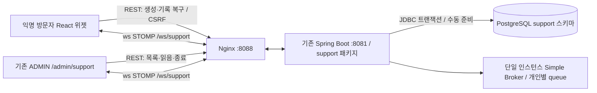

# 실시간 고객센터 MVP

현재 개발은 로컬 소스와 테스트 범위다. Ubuntu `/srv/perfume`의 DB, 계정, `.env`, 컨테이너와 Jenkins는 변경하지 않는다. 기능 기본값은 OFF이며 SQL 자동 실행, 관리자 생성, 데이터 삭제 작업은 없다.

## 구성과 동작



방문자는 우측 하단 채팅 버튼에서 상담을 시작한다. 관리자 부재 시에도 메시지를 저장한다. 닫기·페이지 이동·새로고침은 상담을 삭제하지 않는다. 동일 HttpSession이면 REST로 대화를 복구한다. 관리자는 기존 ADMIN 계정으로 `/admin/support`에 접속해 목록, 마지막 메시지·시각, 미확인 메시지 수, 대화, 답변과 종료를 관리한다.

방문자 식별 UUID와 전송 경로 UUID는 서로 다르며 서버 HttpSession에만 저장한다. 브라우저는 HttpOnly 세션 쿠키를 사용하고 별도 상담 비밀값·관리자 토큰을 localStorage/sessionStorage에 저장하지 않는다. 기존 로그인 시 세션 ID 교체도 유지된다.

**세션 만료·로그아웃 후 익명 상담 복구는 제공하지 않는다.** DB 기록은 남지만 새 세션에 과거 상담 접근 권한을 부여하지 않는다. 같은 세션은 상담방 하나만 만들며 CLOSED 방은 읽기 전용이다. CLOSED 방을 다시 열거나 같은 세션에서 새 방을 만드는 기능은 MVP 범위 밖이다. 서버 재시작은 기본 메모리 HttpSession을 잃으므로 방문자는 새 세션으로 시작하고 관리자는 재로그인 후 저장된 기록을 조회한다. DB 기록의 자동 삭제·보존 기간 관리 기능은 없다. 실제 서비스 공개 전 보존·삭제 정책을 정해야 한다.

## 스키마와 저장 규칙

수동 마이그레이션: [`sql/support-schema.sql`](sql/support-schema.sql).

- `support.conversations`: 방 UUID, 비공개 visitor_key UNIQUE, OPEN/CLOSED, UTC 타임스탬프, 마지막 메시지, 순서/관리자 읽음 위치.
- `support.messages`: 메시지 UUID, 방 FK, 방별 sequence, 클라이언트 UUID, 서버 결정 sender_type, 일반 텍스트(최대 2,000 UTF-16 단위), UTC 타임스탬프.
- `(conversation_id, sequence)`와 `(conversation_id, sender_type, client_message_id)` UNIQUE. 재전송은 동일 메시지를 반환하며 같은 ID로 다른 내용을 보내면 거부한다.
- 방 행 잠금과 트랜잭션으로 순서·중복·상담 종료 경쟁을 처리한다. DB 커밋 이후에만 성공 이벤트를 전송한다. 전송 알림을 놓치면 REST로 저장 결과를 확인한다.
- 메시지 조회는 `after` sequence와 `limit`(기본 50, 최대 100) 커서, 시간 대신 sequence 오름차순을 사용한다. 목록은 50개씩 offset 페이지를 제공한다. 목록이 실시간 갱신 중이면 offset 페이지에 변동이 생길 수 있어 새로 조회를 병행한다.
- 기존 `public`, `ai`, `auth` 스키마를 변경하지 않는다. 신규 테이블은 Hibernate 엔티티가 아니며 애플리케이션은 DDL을 실행하지 않는다. 활성화 시 필수 열의 존재만 읽기 전용 검사한다.

제한: 세션당 방 1개, 전역 신규 방 30개/분, 방·발신자당 새 메시지 10개/10초, 방당 10,000개 메시지, 세션당 WebSocket 3개, 전체 256개, 연결당 구독 ID 4개, 세션당 프레임 120개/10초, STOMP 프레임 16KiB. 전역 입장 제한은 단일 JVM 기준이며 분산 rate limiter는 아니다. 루프백 테스트 DB의 trust 접속은 테스트용이며 실제 서버 인증 정책으로 복사하지 않는다.

## Spring Security와 WebSocket 권한

- 기존 Spring Security, BCrypt, HttpSession, 세션 고정 방어, HttpOnly/SameSite, CSRF, 로그아웃 무효화를 유지한다.
- 고객센터 활성화에는 `perfume.auth.enabled=true`, `ddl-auto=none/validate`, 수동 스키마 준비와 명시적인 Origin 허용 목록이 필요하다. 인증 OFF 상태에서는 관리자/상담 API와 WebSocket을 차단하고 config만 OFF로 반환한다.
- Handshake는 허용 목록의 정확한 Origin, 살아 있는 HttpSession, 기존 CSRF 토큰을 요구한다. 와일드카드·사용자 정보·쿼리·경로가 있는 Origin 설정은 거부한다.
- CONNECT는 Spring Security `XorCsrfChannelInterceptor`로 기존 `/api/auth/csrf`의 마스킹 토큰을 검증한다. CSRF를 끄거나 별도 인증 우회 경로를 만들지 않는다.
- CONNECT/SUBSCRIBE/SEND마다 서버 HttpSession을 확인한다. 발신자 유형은 승인된 destination과 서버 ADMIN 권한에서 결정하며 payload의 role/senderId/senderType으로 결정하지 않는다. 방 ID만으로는 방문자 소유권을 얻을 수 없다.
- 임의 `/topic`, `/queue`, 다른 `/user/...` 구독과 broker 직접 SEND를 거부한다. 허용되지 않은 프레임은 비밀 헤더·본문을 로그에 남기지 않고 연결을 닫는다.
- 관리자 REST도 ADMIN을 요구한다. 기존 WebSocket이어도 현재 세션의 SecurityContext를 다시 검사하며, outbound에서도 세션/관리자 권한을 검사한다. 만료 세션 연결은 5초 간격으로 정리한다. WS 프레임 자체가 만료된 HTTP 세션을 연장하지 않는다.
- 변경 REST는 기존 CSRF 필터가 보호한다. CSRF 오류, DB 오류 등에서 SQL·예외 원문을 클라이언트에 반환하지 않는다. 운영 시 Spring HTTP/STOMP/JDBC 상세 DEBUG/TRACE 로깅을 켜면 본문·헤더가 노출될 수 있으므로 사용하지 않는다.

## REST와 STOMP

| REST | 권한/용도 |
|---|---|
| `GET /api/support/config` | 공개 기능 플래그. OFF 시 DB 접근 없음 |
| `POST /api/support/conversations` | 익명 세션 + CSRF, 기존 방이면 같은 방 반환 |
| `GET /api/support/conversations/current` | 현재 세션 방 또는 `{}` |
| `GET /api/support/conversations/{id}/messages?after=0&limit=50` | 해당 방문자만, 다른 세션/없는 방은 동일 404 |
| `GET /api/admin/support/conversations?offset=0` | ADMIN 목록 |
| `GET /api/admin/support/conversations/{id}/messages` | ADMIN 기록 |
| `POST /api/admin/support/conversations/{id}/read` | ADMIN + CSRF, 본문 `{ "sequence": 12 }`, 단조 증가 |
| `POST /api/admin/support/conversations/{id}/close` | ADMIN + CSRF, 반복 종료 안전 |

| STOMP | 권한/내용 |
|---|---|
| Endpoint `/ws/support` | Origin + HttpSession; CONNECT에 `X-CSRF-TOKEN` |
| SEND `/app/support/visitor.send` | 방문자 본인 방만 |
| SEND `/app/support/admin.send` | 현재 ADMIN만 |
| SUBSCRIBE `/user/queue/support.events` | 해당 세션 소유 방 이벤트만 |
| SUBSCRIBE `/user/queue/support.admin` | ADMIN 목록/대화 이벤트만 |
| SUBSCRIBE `/user/queue/support.errors` | 해당 세션의 안전한 실패 코드 |

SEND 본문: `{ "conversationId": "UUID", "clientMessageId": "UUID", "text": "문의 내용" }`. `MESSAGE`, `CREATED`, `READ`, `CLOSED` 이벤트는 서버에서 개인별 경로로 전달한다. UUID는 식별자이고 권한 토큰이 아니다. 실패 시 400(입력), 401/403(인증·권한), 404(소유권/없음), 409(종료/ID 충돌/한도), 429(빈도), 503(비활성/저장소)을 구분한다.

## React 연결과 화면

`frontend/src/support` 아래에 방문자 위젯/창, 메시지 목록·입력, 관리자 페이지, REST API, STOMP 서비스와 Hook을 분리했다. `@stomp/stompjs` 버전은 lockfile로 고정한다. 닫으면 WS를 정리하고, 다시 열면 REST 기록과 WS 구독을 복원한다.

- 10초 heartbeat, 3초 재연결, 10초 연결 제한. 연결될 때마다 CSRF 갱신과 구독 재등록, 관리자 세션 재검사를 수행한다.
- 재연결 직후와 15초 간격 REST 조회로 누락 알림과 SUBSCRIBE/기록 조회 사이의 경합을 복구한다. 메시지 ID로 중복 제거하고 sequence로 정렬한다. 관리자 방 변경 시 이전 HTTP 응답이 새 방에 적용되지 않게 generation을 검사한다.
- 전송 중 표시는 DB 성공 이벤트/REST 확인 전까지 유지한다. 12초간 확인이 없거나 연결이 끊기면 확인 필요 상태로 바뀐다. 사용자가 재전송하면 같은 clientMessageId를 사용한다. 연결이 끊겼을 때 새 메시지는 전송할 수 없다.
- Enter 전송, Shift+Enter 줄바꿈, IME 조합 중 Enter 보호. 일반 문자열 렌더링으로 HTML을 실행하지 않는다.
- LAN HTTP에서는 `crypto.randomUUID()`를 사용할 수 없으므로 `crypto.getRandomValues()`로 v4 UUID를 만든다.
- Effect 정리 시 client와 timer를 해제하며 비동기 CSRF 완료 후 이미 정리된 연결을 되살리지 않는다. 관리자 세션 만료 시 전송을 차단하고 `/login`으로 이동한다.

## 로컬 검증 실행

Windows Java 17, Maven Wrapper, Node/npm, Chrome이 필요하다. PostgreSQL 검증은 로컬 PostgreSQL 17 실행 파일(`C:\Program Files\PostgreSQL\17\bin`)을 사용한다. 기존 5432, 인증 테스트 25432, 인증 미리보기 18081은 그대로 둔다.

```powershell
cd C:\dev\projects\perfume
# H2 + 실제 loopback HTTP/STOMP 고객센터 검사. IDE 공유 출력과 분리한다.
powershell -NoProfile -ExecutionPolicy Bypass -File scripts/test-support.ps1
# 기존 전체 Java 회귀 검사도 함께 실행
powershell -NoProfile -ExecutionPolicy Bypass -File scripts/test-support.ps1 -All
# 별도 26432 PostgreSQL에서 저장/보안 검사
powershell -NoProfile -ExecutionPolicy Bypass -File scripts/test-support.ps1 -Postgres
# 18082 테스트 서버 + 실제 PostgreSQL + 서로 다른 방문자/관리자 Chrome Context
powershell -NoProfile -ExecutionPolicy Bypass -File scripts/test-support.ps1 -Browser
# 수동 브라우저 확인용으로 18082를 유지. Ctrl+C로 이 스크립트의 서버만 종료.
powershell -NoProfile -ExecutionPolicy Bypass -File scripts/test-support.ps1 -Serve
cd frontend
npm ci
npm test
npm run build
npm run test:browser
```

테스트 DB는 `127.0.0.1:26432/perfume_support_test`, 물리 경로 `target/support-local/data`이며 Docker 볼륨을 사용하지 않는다. 연결 후 `SHOW data_directory`와 DB 이름이 일치하기 전에는 테스트 DDL을 실행하지 않는다. 기존 경로/다른 프로세스를 발견하면 덮어쓰지 않고 중단한다. 테스트 클래스 경로에서만 사용하는 fixture가 해당 새 클러스터에 support/auth 테스트 테이블과 임의 BCrypt 테스트 계정을 준비한다. 이 fixture와 preview launcher는 런타임 JAR에 포함되지 않는다.

테스트 암호는 생성 후 `target/support-local/test-admin.clixml`에 Windows DPAPI로 보관하고 자식 프로세스 환경으로만 전달한다. 실제 Ubuntu admin 암호와 관계없다. 로그, SQL 테스트 데이터, 암호화된 테스트 자격증명, 임시 POM/클래스는 모두 Git 제외 `target/` 아래에 둔다. 실행 스크립트가 시작한 테스트 서버/DB만 종료하며 데이터 삭제는 하지 않는다. 이미 실행 중인 검증된 테스트 DB는 유지한다. 기존 IDE/Maven이 공유하는 `target/classes` 대신 동일 소스를 `target/support-validation`로 컴파일한다.

수동 확인 시 방문자는 `http://127.0.0.1:18082/recommend`, 관리자는 별도 브라우저 프로필에서 `http://127.0.0.1:18082/admin/support`를 연다. 관리자 ID는 테스트 DB의 `admin`이다. 테스트 암호는 아래 명령으로 **자신의 PC에서만 확인**하며 다른 곳에 전송하지 않는다.

```powershell
$testAccount = Import-Clixml .\target\support-local\test-admin.clixml
$testAccount.GetNetworkCredential().Password
```

방문자 A는 일반 창, 방문자 B는 시크릿 창, 관리자는 다른 프로필로 열어 위젯 시작 → 메시지 → 관리자 방 선택/답변 → 각 방문자 분리 → 새로고침 → 종료/로그아웃을 확인한다. 이 preview는 고객센터 전용 테스트 서버이며 실제 향수/AI API나 Ollama에 연결하지 않는다. `-Serve`의 대기 모드는 수동 사용용이고 자동 브라우저 검사는 `-Browser`로 수행한다.

## 개발서버 적용 준비 — 별도 승인 전 실행 금지

1. 로컬 리뷰·검증 후 Commit/Push 및 Jenkins 실행을 별도 승인받는다. 최초 배포는 고객센터 OFF 상태로도 가능하며 기존 HTTP 로그인과 AI 추천 설정은 보존된다.
2. 승인 후 서버에서 현재 DB·볼륨 식별자, 향수/임베딩 수, auth 계정 및 `.env` 비밀값을 노출하지 않는 비교 기준을 남긴다. 기존 auth 스키마/계정이 준비되어 있으므로 auth SQL이나 bootstrap을 다시 실행하지 않는다.
3. 승인한 DB 연결임을 확인한 뒤 **support 전용 SQL 한 개만** 수동 실행한다. 다음은 승인 후 명령 예시이며 이번 개발에서 실행하지 않는다.

```bash
cd /srv/perfume
# 기존 컨테이너/DB 신원을 먼저 검증한 뒤, 사용자 승인 후에만 실행.
docker compose exec -T db psql -X -U perfume_user -d perfume -v ON_ERROR_STOP=1 < docs/sql/support-schema.sql
```

4. 별도 `.env` 수정 승인 후 기존 파일에 다음 두 키만 추가/조정한다. 기존 HTTP 인증 키, DB 암호, AI 모델 digest와 Jenkins 설정은 보존한다.

```dotenv
PERFUME_SUPPORT_ENABLED=true
PERFUME_SUPPORT_ALLOWED_ORIGINS=http://192.168.0.19:8088
```

기존 `PERFUME_AUTH_ENABLED=true`, `PERFUME_AUTH_DEV_HTTP_ENABLED=true`, `auth-dev-http`, HttpOnly/Lax/Secure=false 설정은 그대로 유지한다. `auth-dev` 격리 제한을 변경하지 않는다. 빈 Origin 또는 미준비 스키마에서 활성화하면 시작을 거부한다. Compose guard는 기존 개인 개발서버 Origin만 허용한다. 브라우저도 정확히 `http://192.168.0.19:8088`로 접속해야 한다.

5. 재배포 승인 후 기존 Jenkins 경로로 backend/frontend만 반영한다. `jenkins-deploy.sh`는 지원 플래그의 상속을 제거하고 서버 `.env`만 사용한다. 신규 서비스·포트·볼륨·브로커 컨테이너는 없다. Nginx `/ws/support`만 HTTP/1.1 Upgrade로 전달하며 기존 API 경로와 Healthcheck는 유지한다. Docker 빌드에는 support 테스트 SQL만 별도로 포함하고 runtime stage에는 복사하지 않는다.
6. 실제 Nginx 경유 101/CONNECT, 관리자·방문자 2명 격리, 새로고침/재연결/종료/로그아웃, 기존 로그인/AI 접근 제어, 데이터·볼륨·모델·`.env` 보존을 검증한다. 실제 Ollama 추론은 이 기능과 연결하지 않는다.

롤백은 기능 OFF로 전환하는 별도 승인 후 기존 배포 경로를 사용한다. support 테이블/계정을 DROP하거나 DB/볼륨을 재생성하지 않는다. HTTPS/WSS/8443 gateway를 추가하지 않는다. HTTP/ws는 전송 암호화가 없어 신뢰할 수 있는 개인 LAN에서만 사용한다.

## 한계와 검증 기록

Simple Broker, 메모리 HttpSession, 전역 입장 제한은 단일 인스턴스용이다. 다중 인스턴스에는 공유 세션, 분산 입장 제한과 외부 STOMP broker/전달 신뢰성 설계가 필요하다. DB 커밋과 WS 알림은 하나의 분산 트랜잭션이 아니므로 REST 복구가 최종 기준이다. 장시간/대량 트래픽 부하, 실제 개발서버 Nginx·Docker 업그레이드와 장시간 세션 만료는 배포 전 별도 검증 대상이다.

검증 결과와 생성·변경 파일 목록은 `docs/support-chat-validation.md`에 기록한다.

참고: [Spring Security WebSocket/CSRF](https://docs.spring.io/spring-security/reference/servlet/integrations/websocket.html), [Spring 사용자별 destination](https://docs.spring.io/spring-framework/reference/web/websocket/stomp/user-destination.html), [StompJS 연결·재연결](https://stomp-js.github.io/guide/stompjs/using-stompjs-v5.html).
